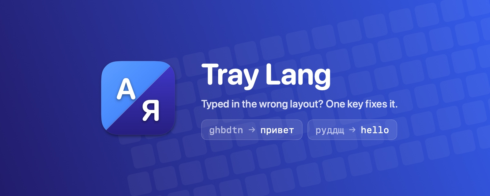
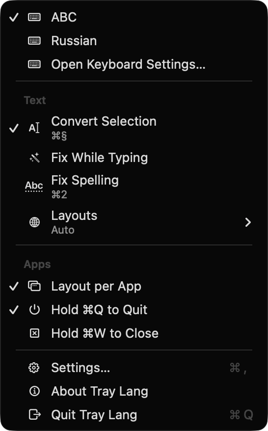
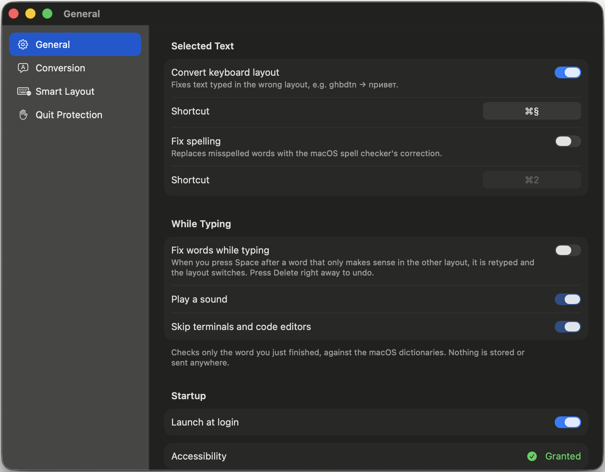
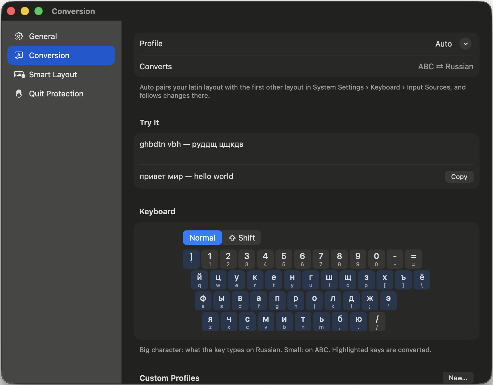
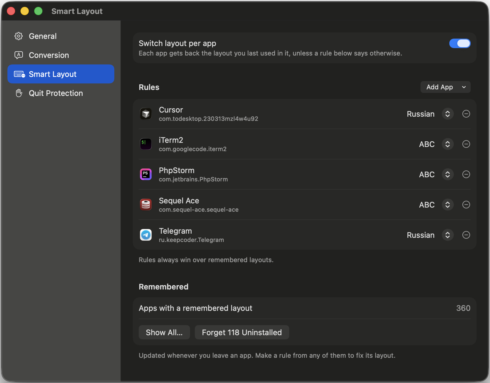
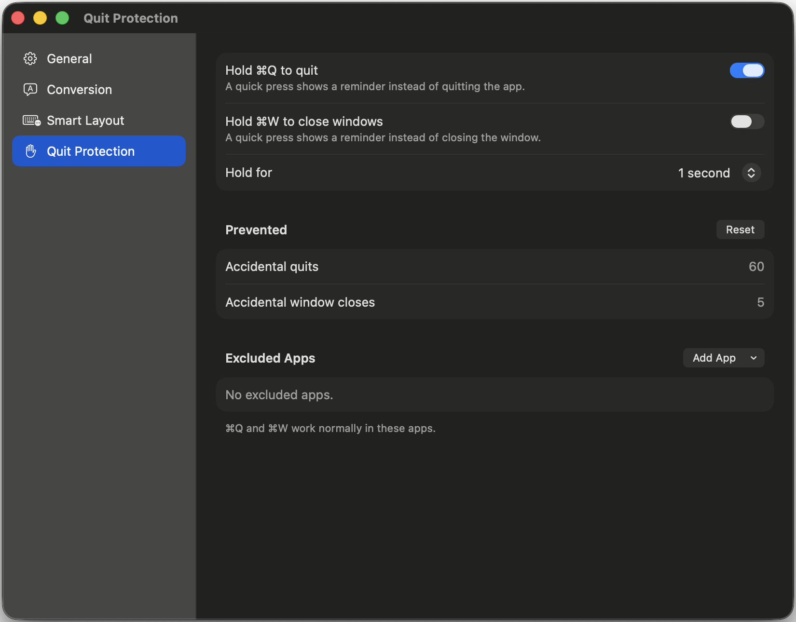

<p align="center">
  
</p>

<p align="center">
  <a href="https://github.com/s00d/tray-lang/releases/latest"></a>
  <a href="https://github.com/s00d/tray-lang/releases"></a>
  
  
  <a href="https://www.donationalerts.com/r/s00d88"></a>
</p>

<p align="center">
  <b>A tiny menu bar app that fixes text typed in the wrong keyboard layout.</b><br>
  Select <code>ghbdtn</code>, press <kbd>⌘</kbd> <kbd>1</kbd>, get <code>привет</code>. Press again to undo.
</p>

<p align="center">
  <a href="https://github.com/s00d/tray-lang/releases/latest"><b>⬇ Download for macOS</b></a>
</p>

---

## Features



**Convert the selection** — select text in any app and press the hotkey. Every word flips to the other layout, so mixed text works too: `фыва ghjjk` → `asdf проол`. The keyboard layout switches to match what you are about to type.

**Fix while typing** *(off by default)* — when you press <kbd>Space</kbd> after a word that only makes sense in the other layout, it is retyped and the layout switches, with a barely audible tone. <kbd>Delete</kbd> right after undoes it, and that word is left alone from then on.

**Exact for your keyboard** — key tables are read from macOS itself, so punctuation lands right on Russian *and* Russian – PC, Ukrainian, Belarusian, Greek, Hebrew, Arabic, German, French, Nordic, Dvorak, Colemak and any other installed layout.

**Layout per app** — every app gets back the layout you last used in it, or a fixed one you choose.

**Hold ⌘Q / ⌘W** — a quick press shows a reminder instead of quitting the app or closing the window. Hold to confirm.

**Input menu replacement** — switch input sources right from the Tray Lang menu and hide the system one.

**Fix spelling** — a second hotkey replaces misspelled words with the macOS correction, picking Russian, Ukrainian or English per word.

<br clear="right">

## Settings

<table>
  <tr>
    <td width="50%"></td>
    <td width="50%"></td>
  </tr>
  <tr>
    <td align="center"><b>General</b> — hotkeys, fixing while typing, launch at login</td>
    <td align="center"><b>Conversion</b> — profile, live preview, the keyboard as macOS types it</td>
  </tr>
  <tr>
    <td width="50%"></td>
    <td width="50%"></td>
  </tr>
  <tr>
    <td align="center"><b>Smart Layout</b> — per-app rules and remembered layouts</td>
    <td align="center"><b>Quit Protection</b> — ⌘Q / ⌘W, hold time, excluded apps</td>
  </tr>
</table>

## Install

1. Download the DMG from **[Releases](https://github.com/s00d/tray-lang/releases/latest)** — signed and notarized, universal (Apple Silicon + Intel).
2. Drag **Tray Lang** to Applications and launch it. It lives in the menu bar.
3. Allow **Accessibility** access when asked (System Settings › Privacy & Security › Accessibility). It is needed to read and replace selected text, watch typing for *Fix while typing*, and hold back ⌘Q / ⌘W.

Requires macOS 15 or later.

## How it works

- **Profiles are pairs of macOS layouts.** The app asks macOS (`UCKeyTranslate`) what every key types on each layout, including dead keys. **Auto** pairs your latin layout with the first other input source you have enabled and follows changes in System Settings. You can also pick any installed layout, or make a custom table starting from one.
- **Per word.** Letters always flip to the other side; punctuation that exists on both layouts follows its word. On Russian (Mac) `ghbdtn^` becomes `привет,`; on Russian – PC `ghbdtn?` does.
- **Replacing text never inserts it twice.** Accessibility is tried first and the result is checked before falling back to the clipboard. Copy and paste go through the app's own Edit menu, synthetic ⌘C / ⌘V only as a last resort, and your clipboard is restored afterwards.
- **Terminals** (Terminal, iTerm2, Warp, kitty…) convert the current command line. Code editors that copy the whole line without a selection (VS Code, Cursor, JetBrains, Sublime, Zed) are recognised, so nothing happens when nothing is selected.
- **Light by design.** Idle at 0% CPU and about 15 MB of memory: no polling, no helper processes, no network. *Fix while typing* keeps only the current word in memory and installs its key monitor only while it is on.

## Troubleshooting

**The hotkey does nothing.** Open Settings › General: Accessibility must be *Granted* and *Convert keyboard layout* on. If a password field or another app holds Secure Input, macOS blocks keyboard access; the settings show which app.

**Punctuation comes out wrong.** Pick the layout you actually type on in Settings › Conversion (for example Russian vs Russian – PC). Auto uses the first non-latin input source you have enabled.

**A Dock icon appears.** Only while Settings is open, so the window can come to the front.

## Development

```bash
make test      # unit tests, ad-hoc signed; full log in build/test.log
make run       # debug build, opens Settings
make install   # signed universal build → /Applications, restarts the app
```

The tests drive the hotkey flow against fake apps (native fields, apps that lie about Accessibility writes, stale selections, line-copying editors, terminals) and check that every key of every built-in layout converts there and back. They need a real Mac session (input sources, dictionaries, pasteboard), so they run locally rather than in CI.

<details>
<summary>Architecture</summary>

AppKit status item and windows hosting SwiftUI views.

- `AppCoordinator` — owns the managers and wires settings to services
- `SystemKeyboardLayouts` — key tables of macOS layouts (`TISInputSource` + `UCKeyTranslate`), main-thread TIS access
- `TextTransformer` — profiles and per-word conversion
- `TextProcessingManager` — hotkey flow: read selection → convert → replace → switch layout, through `SelectionDriver`
- `SystemSelectionDriver` — Accessibility, Edit-menu actions, clipboard, synthetic keys
- `AutoConvertManager` — fixing while typing (engine + key monitor)
- `KeyboardLayoutManager`, `SmartLayoutManager`, `HotKeyManager` (Carbon hotkeys), `HotkeyBlockerManager` (event tap), `SpellCheckManager`
- `WindowManager` — menu bar menu, main menu, settings window

</details>

<details>
<summary>Releasing</summary>

1. Run `make test` locally.
2. Bump `MARKETING_VERSION` and `CURRENT_PROJECT_VERSION` (app target) and push.
3. Run the **Release** workflow: `gh workflow run build.yml --ref main`. It builds a universal Developer ID app, notarizes and staples the app and the DMG, and publishes `vX.Y` with release notes and a SHA-256 checksum. It refuses to run if the tag already exists.

</details>

## License

© 2025–2026 s00d. All rights reserved.
