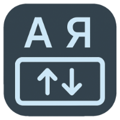
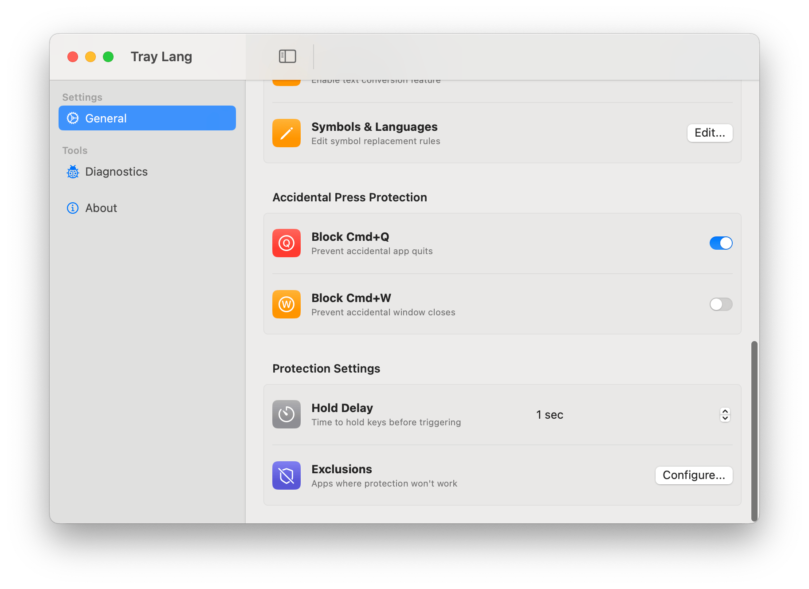
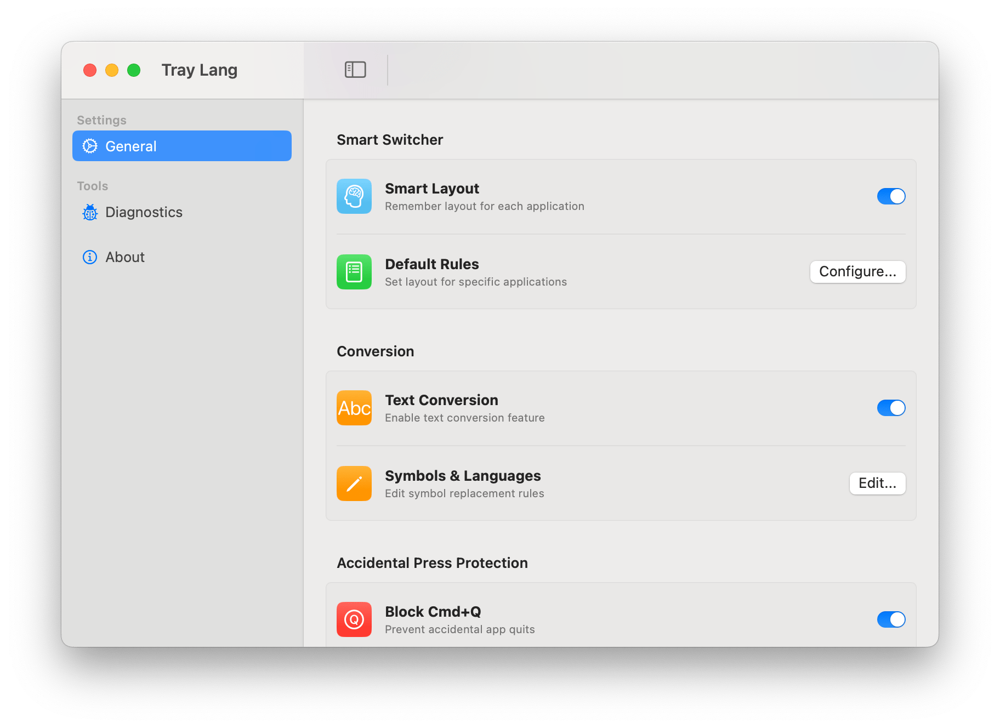
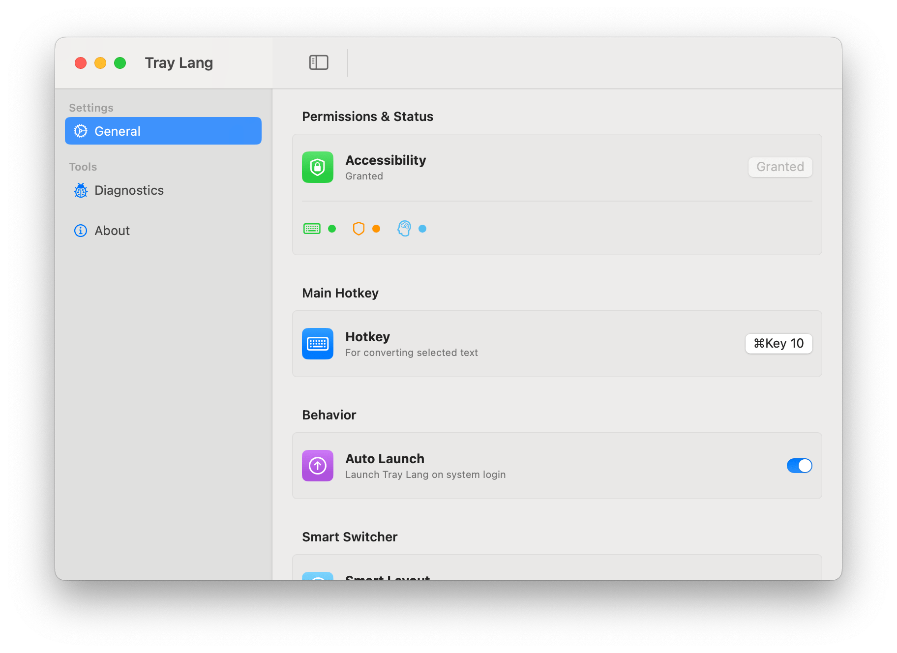

[](https://github.com/s00d/tray-lang)
[](https://github.com/s00d/tray-lang)
[](https://github.com/s00d/tray-lang/releases)
[](https://github.com/s00d/tray-lang/releases)
[](https://github.com/s00d/tray-lang/issues)
[](https://github.com/s00d/tray-lang/stargazers)
[](https://www.donationalerts.com/r/s00d88)

<div align="center">
  
</div>

# Tray Lang

A powerful macOS application that transforms text between keyboard layouts, prevents accidental app quits, and intelligently manages keyboard layouts per application.





## What it does

**Text Transformation**: Select text typed in the wrong layout, press a hotkey, and it is retyped as if the right layout had been on — `ghbdtn` → `привет`, `руддщ` → `hello`, and mixed text like `фыва ghjjk` → `asdf проол` in one go. Press again to undo. The keyboard layout switches to match.

**Fix While Typing** (off by default): when you press Space after a word that only makes sense in the other layout — `ghbdtn` → `привет`, `руддщ` → `hello` — it is retyped and the layout switches, with a barely audible 75 ms tone. Press Delete right away to undo; that word is then left alone.

**Smart Layout Switching**: Remembers the layout you used in each app and restores it, with optional fixed rules per app.

**Quit Protection**: A quick ⌘Q / ⌘W shows a reminder; hold it for 1–5 seconds to actually quit or close.

## Quick Start

1. Build from source (`make build`) or download a release
2. Allow Accessibility access when asked
3. Select text → press **⌘1** (change it in Settings › General)

## How conversion works

- **Key tables come from macOS.** Every profile is a pair of keyboard layouts installed on your Mac; the app asks macOS (`UCKeyTranslate`) what each key types on each layout. Nothing is hard-coded, so Russian (Mac) and Russian – PC, Ukrainian, Belarusian, Greek, Hebrew, Arabic, German, French, Nordic, Dvorak, Colemak… are all exact, including dead keys.
- **Auto profile** (default) pairs your latin layout with the first other layout enabled in System Settings › Keyboard › Input Sources. Pick any other installed layout in Settings › Conversion, or make a custom table by duplicating one.
- **Per word.** Letters always flip to the other layout. Punctuation that exists on both layouts (`.` `,` `;` `"`…) follows the word it is in, so `ghbdtn^` becomes `привет,` on Russian (Mac) and `ghbdtn?` becomes `привет,` on Russian – PC.
- **Replacing the text** tries Accessibility first and checks that the app really changed the text before falling back to the clipboard, so text is never inserted twice. Copy and paste go through the app's own Edit menu when it has one (works on any layout), with ⌘C/⌘V as the last resort. The clipboard is restored afterwards unless something else wrote to it.
- **While typing**, only the current word is kept in memory, checked against the macOS dictionaries when you press Space, and only between different scripts (Latin ↔ Cyrillic/Greek/Hebrew…). Digits, `@`, `/`, `_` and terminals/code editors are skipped. The word is retyped with Unicode key events (no clipboard), and the app ignores its own events. While the feature is off no key monitor is installed at all.
- **Terminals** (Terminal, iTerm2, Warp, kitty, …): the current command line is converted. Editors that copy the whole line without a selection (VS Code, Cursor, JetBrains, Sublime, Zed) are recognised, so nothing is pasted when nothing is selected.

## Settings

- **Menu bar**: current layout and warnings; Text (Convert Selection, Fix While Typing, Fix Spelling, Layouts); Apps (Layout per App, Hold ⌘Q / ⌘W); Settings…, About, Quit.
- **General**: permissions status, hotkeys (click and press a new shortcut), fixing while typing, launch at login.
- **Conversion**: profile, a live "Try It" field, the key table, custom profiles.
- **Smart Layout**: on/off, per-app rules, remembered layouts.
- **Quit Protection**: ⌘Q / ⌘W, hold time, statistics, excluded apps.

## Requirements

- macOS 15.0+
- Accessibility permissions (for text manipulation and hotkey blocking)

## Installation

### From Source
```bash
git clone <repository>
cd tray-lang
make build
```

## Troubleshooting

**Nothing happens on the hotkey** — check Settings › General: Accessibility must be granted and "Convert keyboard layout" on. If another app holds Secure Input (password fields, some terminals), macOS blocks reading keys; the settings show which app.

**Punctuation converts to the wrong sign** — pick the exact layout you type on in Settings › Conversion (for example Russian vs Russian – PC); Auto uses the first non-latin layout you have enabled.

**Dock icon appears** — only while the Settings window is open, so it can come to the front.

## Architecture

AppKit status item and windows hosting SwiftUI views (a SwiftUI `MenuBarExtra` + `Settings` scene cannot reliably bring its window to the front from a menu bar app).

- `AppCoordinator` — owns the managers, wires settings to services
- `SystemKeyboardLayouts` — reads key tables of macOS layouts (`TISInputSource` + `UCKeyTranslate`); TIS calls are kept on the main thread
- `TextTransformer` — profiles and the per-word conversion
- `TextProcessingManager` — hotkey flow: read selection → convert → replace → switch layout; talks to the system only through `SelectionDriver`
- `SystemSelectionDriver` — Accessibility, Edit-menu actions, clipboard, synthetic keys
- `KeyboardLayoutManager`, `SmartLayoutManager`, `HotKeyManager` (Carbon hotkeys), `HotkeyBlockerManager` (event taps), `SpellCheckManager`
- `WindowManager` — menu bar menu, main menu, settings window

## Testing

```bash
make test
```

Runs the unit tests ad-hoc signed (no developer certificate needed) and writes the full log to `build/test.log`. Under tests the app does not create its menu bar item, uses a throwaway UserDefaults suite and never touches the real clipboard, layouts or Accessibility: the hotkey flow runs against fake apps (`FakeTextApp`) that reproduce native fields, apps that lie about Accessibility writes, stale selections, line-copying editors and terminals. Every key of every built-in layout is checked to convert there and back.

`make test-ui` launches the real app and needs Accessibility for the test runner.

## License

© 2025 All rights reserved

## Developer

Developed by s00d
